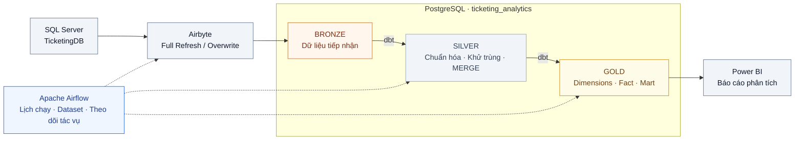
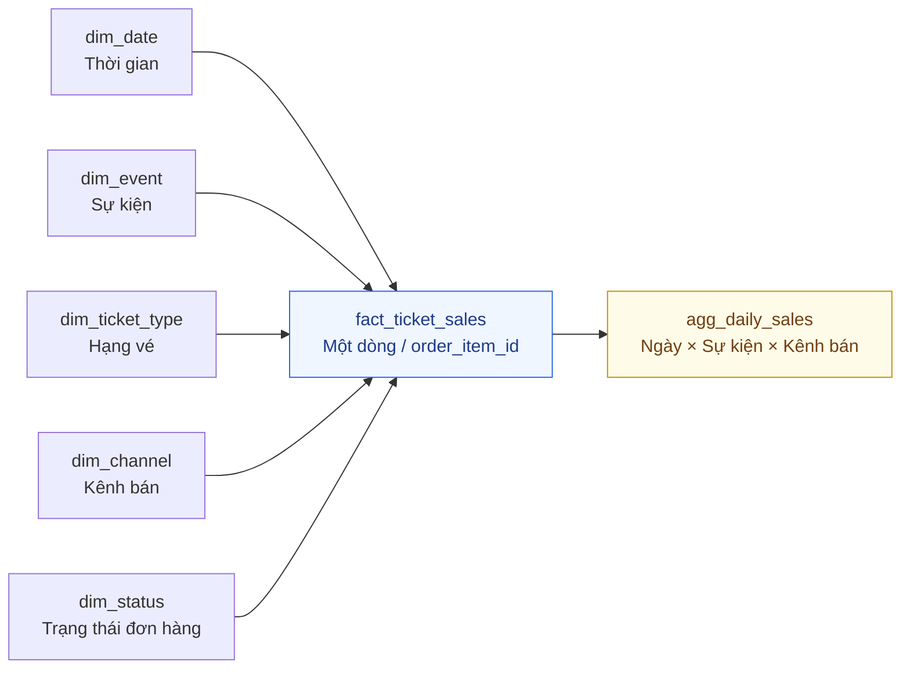

<div align="center">

# Ticket Project

### Thiết kế và xây dựng hệ thống xử lý dữ liệu bán vé sự kiện<br>theo quy trình ELT và kiến trúc Medallion

**KHÓA LUẬN TỐT NGHIỆP · KHOA HỌC MÁY TÍNH · 2026**


Từ dữ liệu giao dịch đến mô hình phân tích bán vé sự kiện.

[Tổng quan](#tổng-quan) · [Kiến trúc](#kiến-trúc-hệ-thống) · [Khởi chạy](#hướng-dẫn-khởi-chạy) · [Tài liệu](#tài-liệu-và-sản-phẩm-bàn-giao)

</div>

---

## Thông tin đề tài

| Nội dung | Thông tin |
| :--- | :--- |
| **Sinh viên thực hiện** | Nguyễn Hoàng Hiệp |
| **Đơn vị đào tạo** | Trường Công nghệ — Đại học Kinh tế Quốc dân |
| **Ngành** | Khoa học máy tính |
| **Định hướng** | Kỹ thuật dữ liệu · Kho dữ liệu · Phân tích kinh doanh |
| **Năm thực hiện** | 2026 |
| **Báo cáo khóa luận** | [Bản PDF](12220016-NguyenHoangHiep.pdf) · [Bản Word](12220016-NguyenHoangHiep.docx) |

## Tổng quan

Hoạt động bán vé sự kiện tạo ra nhiều nhóm dữ liệu có quan hệ chặt chẽ: sự kiện, hạng vé, đơn hàng, chi tiết đơn hàng và thanh toán. Để sử dụng những dữ liệu này trong báo cáo, hệ thống cần thống nhất kiểu dữ liệu, xử lý bản ghi trùng lặp và cập nhật các chỉ tiêu khi trạng thái giao dịch thay đổi.

Đề tài xây dựng quy trình **ELT — Extract, Load, Transform**: trích xuất dữ liệu từ SQL Server, nạp vào PostgreSQL bằng Airbyte, sau đó biến đổi bằng dbt. Kiến trúc **Medallion** phân chia dữ liệu thành ba tầng Bronze, Silver và Gold. Apache Airflow quản lý thứ tự thực thi; Power BI khai thác mô hình đầu ra để minh họa các chỉ tiêu bán vé.

Trọng tâm kỹ thuật của đề tài gồm:

- **Tổ chức dữ liệu theo tầng:** phân định dữ liệu tiếp nhận, dữ liệu chuẩn hóa và dữ liệu phục vụ phân tích.
- **Xử lý thay đổi:** khử trùng theo khóa nghiệp vụ, so sánh hash nội dung và cập nhật tăng dần bằng `MERGE`.
- **Mô hình hóa nghiệp vụ:** xác định mức chi tiết của bảng fact, tránh tính lặp số vé và giá trị bán vé khi một đơn có nhiều lần thanh toán.
- **Điều phối theo dữ liệu:** kích hoạt Silver và Gold dựa trên Dataset được phát khi tác vụ đầu vào thành công.
- **Khai thác kết quả:** xây dựng bảng tổng hợp và các phép đo DAX cho báo cáo Power BI.

> **Phạm vi dữ liệu:** dữ liệu được sinh tổng hợp bằng Python để mô phỏng nghiệp vụ bán vé, không phải giao dịch thực tế của Ticketbox và không chứa thông tin cá nhân khách hàng. Các chỉ tiêu phục vụ minh họa, không đại diện cho kết quả kinh doanh hoặc thị trường thực tế.

## Kiến trúc hệ thống



### Vai trò các tầng dữ liệu

| Tầng | Trách nhiệm | Cách cập nhật |
| :--- | :--- | :--- |
| **Bronze** | Tiếp nhận 5 bảng nghiệp vụ từ SQL Server; làm đầu vào cho dbt. | Airbyte đồng bộ toàn bộ và ghi đè snapshot. |
| **Silver** | Ép kiểu, chuẩn hóa chuỗi, khử trùng; nhận diện bản ghi mới, thay đổi, biến mất hoặc xuất hiện trở lại. | Incremental `MERGE`; xóa mềm bằng `_is_deleted`. |
| **Gold** | Tổ chức mô hình phân tích theo các chiều nghiệp vụ và tổng hợp chỉ tiêu. | Fact dùng incremental `MERGE`; dimension và mart được tạo lại. |

Ba tầng được tổ chức bằng các schema trong cùng database `ticketing_analytics`. dbt đọc trực tiếp Bronze qua `source()` và liên kết các model qua `ref()`.

**Lưu ý về incremental:** Silver và fact vẫn đọc snapshot để đối chiếu; cơ chế tăng dần giảm số dòng ghi vào đích. Thiết kế hiện tại chưa sử dụng CDC hoặc lưu lịch sử SCD Type 2.

### Công nghệ triển khai

| Thành phần | Công nghệ / phiên bản trong dự án | Vai trò |
| :--- | :--- | :--- |
| Dữ liệu nguồn | SQL Server, Python | Lưu trữ và sinh dữ liệu nghiệp vụ mô phỏng. |
| Tích hợp dữ liệu | Airbyte local, abctl `0.30.4` | Đồng bộ SQL Server → PostgreSQL. |
| Kho dữ liệu | PostgreSQL `17.9` | Lưu trữ Bronze, Silver và Gold. |
| Biến đổi dữ liệu | dbt-core `1.9.8`, dbt-postgres `1.9.0` | Quản lý SQL model, phụ thuộc, contracts và data tests. |
| Điều phối | Apache Airflow `2.10.5`, Python `3.11` | Quản lý DAG, lịch đồng bộ và Dataset. |
| Trực quan hóa | Power BI | Mô hình báo cáo và các chỉ tiêu DAX. |
| Môi trường | Docker Desktop, Docker Compose, PowerShell | Đóng gói dịch vụ và hỗ trợ vận hành local. |

Airbyte được triển khai riêng bằng `abctl`; Airflow và PostgreSQL được khai báo trong `compose.yaml`. Môi trường Python của dbt được tách khỏi Airflow để quản lý phụ thuộc.

## Mô hình dữ liệu và chỉ tiêu phân tích

### Dữ liệu đầu vào

| Bảng nguồn | Nội dung | Model Silver |
| :--- | :--- | :--- |
| `events` | Thông tin sự kiện | `silver_events` |
| `ticket_types` | Hạng vé của sự kiện | `silver_ticket_types` |
| `orders` | Đơn hàng, kênh bán và trạng thái | `silver_orders` |
| `order_items` | Các dòng vé trong đơn hàng | `silver_order_items` |
| `payments` | Các lần thanh toán của đơn hàng | `silver_payments` |

Chi tiết trường, khóa và quan hệ được mô tả trong [từ điển dữ liệu nguồn](Source/SqlServer/DATA_DICTIONARY.md).

### Mô hình phân tích Gold



| Chỉ tiêu | Quy tắc tính |
| :--- | :--- |
| **Giá trị vé đã thanh toán** | Tổng `sales_amount`; chỉ ghi nhận khi đơn có trạng thái `PAID`. |
| **Số vé đã bán** | Tổng `sold_quantity`; chỉ ghi nhận khi đơn có trạng thái `PAID`. |
| **Số đơn đã thanh toán** | Đếm phân biệt `order_id` của các đơn `PAID`. |
| **Giá trị trung bình đơn** | Giá trị vé đã thanh toán / Số đơn đã thanh toán. |
| **Tỷ lệ đơn thanh toán** | Số đơn đã thanh toán / Tổng số đơn. |

Giá trị bán vé được ghi nhận theo **ngày đặt hàng**, với tiền tệ VND và thời gian nghiệp vụ Việt Nam (UTC+07:00). Fact không nối trực tiếp với `payments` để tránh nhân bản dòng khi một đơn có nhiều lần thanh toán. Số đơn là chỉ tiêu đếm phân biệt, cần tính lại theo phạm vi lọc thay vì cộng tùy ý giữa các nhóm.

Tệp báo cáo: [Dashboards.pbix](PowerBI/Dashboards.pbix) · [Các phép đo DAX](PowerBI/powerbi_measures.dax) · [Truy vấn BI](PowerBI/bi_queries.sql).

## Điều phối xử lý

Luồng tự động hiện hành sử dụng **Airflow Datasets**:

1. **Bronze:** DAG gọi Airbyte, chờ job thành công rồi phát Dataset tương ứng.
2. **Silver:** mỗi bảng có một DAG, được kích hoạt khi Dataset Bronze của bảng cập nhật.
3. **Gold dimensions:** chờ đủ 5 Dataset Silver trước khi xử lý các bảng chiều.
4. **Gold fact:** chờ đủ 5 dimension rồi cập nhật `fact_ticket_sales`.
5. **Gold mart:** cập nhật `agg_daily_sales`; sau khi hoàn tất có thể refresh Power BI.

Các DAG `silver_ticket_all` và `gold_ticket_all` phục vụ khởi tạo hoặc rebuild thủ công. Lịch Bronze và Connection ID được quản lý trong [thư mục DAG Bronze](Airflow/dags/bronze/); Silver và Gold tự động chạy theo Dataset.

> Dataset xác nhận đầu vào đã có cập nhật, nhưng không bảo đảm tất cả bảng thuộc cùng một batch. Gold cũng được cập nhật theo từng model. Chỉ refresh Power BI khi chuỗi xử lý đã hoàn tất và không có lượt xử lý mới đang ghi dữ liệu.

## Cấu trúc mã nguồn

```text
Ticket_Project/
├── Source/SqlServer/        # Schema, từ điển dữ liệu và chương trình sinh dữ liệu
├── Airbyte/                # Hướng dẫn connector và công cụ abctl local
├── Airflow/
│   ├── dags/bronze/         # Đồng bộ dữ liệu bằng Airbyte
│   ├── dags/silver/         # DAG chuẩn hóa từng bảng và khởi tạo toàn tầng
│   ├── dags/gold/           # DAG dimension, fact và mart
│   └── plugins/ticketing/   # API client, sensor và dbt operators/runner
├── Dbt/Dbt-Postgres/
│   ├── models/silver/      # 5 model chuẩn hóa dữ liệu
│   ├── models/gold/        # 5 dimension, 1 fact và 1 mart
│   └── macros/             # Hash nghiệp vụ và xử lý cập nhật tăng dần
├── Postgres/sql/           # Khởi tạo database, schema và phân quyền
├── PowerBI/                # Báo cáo PBIX, truy vấn SQL và phép đo DAX
├── Docker/                 # Dockerfile triển khai Airflow và dbt
├── Scripts/                # Script PowerShell hỗ trợ vận hành
├── Documentation/          # Tài liệu kiến trúc, dữ liệu và điều phối
├── Runtime/                # Dữ liệu chạy và artifacts cục bộ
├── compose.yaml            # Cấu hình các dịch vụ Docker Compose
└── README.md
```

## Hướng dẫn khởi chạy

### 1. Chuẩn bị môi trường

- Docker Desktop đang chạy ở chế độ **Linux containers**, có Docker Compose.
- PowerShell, SQL Server và database nguồn `TicketingDB` đã được thiết lập.
- Power BI Desktop để mở báo cáo; Python và ODBC driver nếu cần sinh hoặc nạp dữ liệu nguồn.

Tham khảo [thiết lập dữ liệu SQL Server](Source/SqlServer/README.md) và [cấu hình Airbyte](Airbyte/README.md) trước khi chạy pipeline lần đầu.

### 2. Cấu hình và khởi động dịch vụ

Mở PowerShell tại thư mục gốc `Ticket_Project`. Tạo cấu hình local nếu chưa có:

```powershell
if (-not (Test-Path .env)) { Copy-Item .env.example .env }
```

Điền các biến kết nối và thông tin xác thực trong `.env`. Kiểm tra ánh xạ Airbyte Connection ID tại `Airflow/dags/bronze/config.py` trước khi bật DAG. Giữ `.env` trên máy local, không đưa thông tin xác thực vào repository.

Khởi động Airflow và PostgreSQL:

```powershell
.\Scripts\start.ps1
```

Nếu máy chưa cài Airbyte local, triển khai bằng:

```powershell
.\Scripts\install-airbyte.ps1 -Deploy
```

Nếu cluster Airbyte đã tồn tại, khởi động bằng:

```powershell
.\Scripts\airbyte.ps1 -Action start
```

| Dịch vụ | Địa chỉ local | Mục đích |
| :--- | :--- | :--- |
| Airflow | <http://localhost:8080> | Theo dõi và điều khiển DAG. |
| Airbyte | <http://localhost:8000> | Cấu hình source, destination và connection. |
| PostgreSQL warehouse | `localhost:5433` / `ticketing_analytics` | Truy vấn dữ liệu và kết nối Power BI. |

### 3. Khởi tạo và vận hành pipeline

1. Cấu hình Airbyte đồng bộ đủ 5 bảng vào schema `bronze` với chế độ **Full Refresh / Overwrite**; để lịch Airbyte ở Manual khi điều phối bằng Airflow.
2. Giữ các DAG tự động Silver/Gold ở trạng thái Paused trong lúc khởi tạo. Hoàn tất đồng bộ Bronze và bảo đảm không có sync đang chạy.
3. Trigger `silver_ticket_all`, sau đó `gold_ticket_all`. Với lần khởi tạo hoặc chuyển đổi cấu trúc đích, chọn `full_refresh=true` để xây dựng lại các bảng.
4. Sau khi khởi tạo thành công, bật các DAG Silver/Gold riêng lẻ. Chọn `bronze_ticket_all` **hoặc** các DAG Bronze từng bảng phù hợp với connection thực tế; không bật cả hai cho cùng đợt đồng bộ.
5. Trong vận hành thường ngày, dùng `full_refresh=false`. Chờ `gold_ticket_agg_daily_sales` thành công rồi refresh báo cáo Power BI.

Hai DAG `silver_ticket_all` và `gold_ticket_all` chỉ dùng thủ công; không chạy chồng với pipeline tự động. Xem chi tiết tại [hướng dẫn điều phối bằng Dataset](Documentation/AIRFLOW_DATASET_WORKFLOW.md).

### 4. Kiểm tra dữ liệu và tài liệu dbt

Các DAG hiện hành gọi `dbt run`, không tự chạy data tests. Khi dữ liệu đã sẵn sàng và không có pipeline đang ghi, có thể kiểm tra theo yêu cầu:

```powershell
docker compose run --rm dbt-postgres test --stage silver
docker compose run --rm dbt-postgres test --stage gold
```

Sinh tài liệu mô hình và quan hệ phụ thuộc:

```powershell
docker compose run --rm dbt-postgres docs
```

Kết quả kiểm thử và số liệu đối chiếu cần được ghi nhận từ lần chạy thực tế; việc khai báo tests trong YAML không đồng nghĩa dữ liệu đã vượt qua kiểm thử.

## Tài liệu và sản phẩm bàn giao

| Tài liệu / sản phẩm | Nội dung |
| :--- | :--- |
| [Báo cáo khóa luận — PDF](12220016-NguyenHoangHiep.pdf) | Thuyết minh đề tài, thiết kế hệ thống và kết quả khảo sát. |
| [Báo cáo khóa luận — Word](12220016-NguyenHoangHiep.docx) | Bản báo cáo có thể chỉnh sửa. |
| [Điều phối bằng Dataset](Documentation/AIRFLOW_DATASET_WORKFLOW.md) | Luồng kích hoạt, khởi tạo và giới hạn nhất quán dữ liệu. |
| [Tổ chức Airflow](Airflow/README.md) | Cấu trúc DAG theo tầng và các module dùng chung. |
| [Mô hình dbt](Dbt/Dbt-Postgres/README.md) | Quy tắc biến đổi, cập nhật tăng dần và cấu hình models. |
| [Luồng dữ liệu dbt](Documentation/DBT_DATA_FLOW.md) | Giải thích nguồn, model, `source()` và `ref()`. |
| [Thiết lập Airbyte](Airbyte/README.md) | Source SQL Server, destination PostgreSQL và kết nối Airflow. |
| [Dữ liệu nguồn](Source/SqlServer/README.md) | Tạo bộ dữ liệu mô phỏng và bổ sung dữ liệu lịch sử. |
| [Từ điển dữ liệu](Source/SqlServer/DATA_DICTIONARY.md) | Trường dữ liệu, khóa và ràng buộc nghiệp vụ. |
| [Dashboard Power BI](PowerBI/Dashboards.pbix) | Báo cáo khai thác dữ liệu đầu ra của hệ thống. |

## Giới hạn và hướng phát triển

Phiên bản hiện tại phục vụ nghiên cứu và triển khai local. Một số giới hạn cần được xem xét khi mở rộng:

- **Tính đầy đủ của snapshot:** xử lý xóa mềm dựa trên việc khóa biến mất khỏi snapshot đầy đủ; dữ liệu nguồn chỉ chứa một phần có thể dẫn đến diễn giải sai.
- **Nhất quán giữa các tầng:** Dataset chưa kiểm soát cùng batch và Gold chưa có cơ chế công bố nguyên tầng trong một transaction.
- **Lịch sử thay đổi:** mô hình hiện tại lưu trạng thái hiện hành; CDC và SCD Type 2 là các hướng mở rộng.
- **Đánh giá chất lượng và hiệu năng:** cần thực thi data tests, đối chiếu nội dung và đo hiệu năng trên các quy mô dữ liệu cụ thể.
- **Vận hành mở rộng:** cơ chế cảnh báo tự động, tính sẵn sàng cao và triển khai production cần được thiết kế và kiểm chứng thêm.

---

<div align="center">

**Nguyễn Hoàng Hiệp** · Khóa luận tốt nghiệp · Đại học Kinh tế Quốc dân · 2026

</div>
